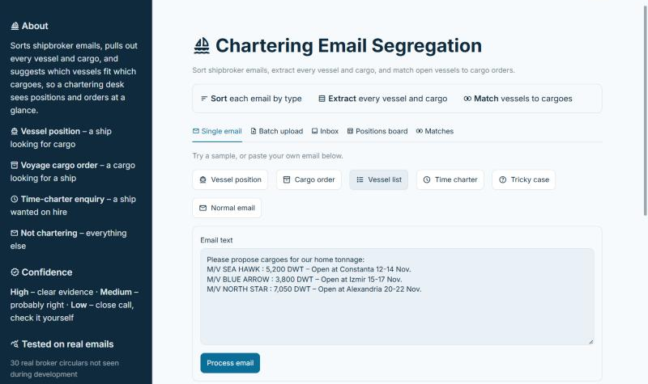
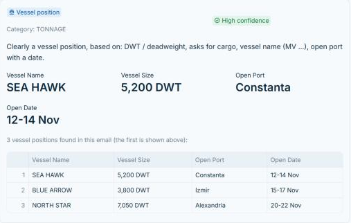
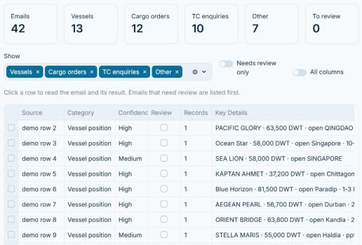
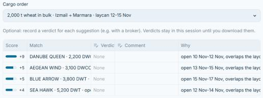
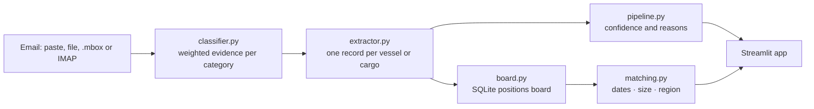

# Chartering Email Segregation

[](https://github.com/deepanshi-code/IME_EMIAL_SEGREGATION/actions/workflows/tests.yml)

[](https://ime-email-segregation.streamlit.app/)

Reads shipbroker emails, sorts them into **vessel positions, cargo orders and time-charter
enquiries**, extracts the details of every vessel and cargo, and suggests **which open vessels fit
which cargoes**, explaining every decision. Built for the IME Innovation Challenge.

**[Try the live demo →](https://ime-email-segregation.streamlit.app/)** Click *Vessel list*, then
*Positions board → Load demo board → Matches*. The demo uses invented emails.



## The problem

Chartering desks receive a steady stream of broker circulars written in dense shorthand:

```
M/V SEA HAWK : 5,200 DWT – Open at Constanta 12-14 Nov.
Pls offer firm for; Kandla / Subic Bay / 8k mt bagged rice / 20 nov onwards / 1500x/1000x
```

Someone reads each one to keep track of which ships are free where, and which cargoes need a ship.
This project automates the first pass: sorting, extracting and suggesting matches, while flagging
the cases it is unsure about for a person to check.

## What it does

- **Sorts** each email into a vessel position, voyage cargo order, time-charter enquiry or
  not chartering, with a confidence level and a plain-language reason.
- **Extracts every record**, not just the first: vessel name, DWT/cargo capacity, open port and
  date; or load/discharge port, cargo, quantity and laycan. It reads broker shorthand such as
  "42-4500 MT" = 4,200–4,500 t, "7.331,1 DWT" and "27-28/OCT".
- **Reads a mailbox**: an exported .mbox file, or a **read-only** IMAP connection.
- **Keeps a positions board** you can search and filter by region, dates and size, and export to Excel.
- **Matches vessels to cargoes** by dates, size and location, with reasons for every suggestion.

Each tab and field is described in the [app guide](docs/APP_GUIDE.md).





## Results

Measured on data the rules were **not** developed on ([full evaluation](docs/EVALUATION.md)):

| Test set | Result |
|----------|--------|
| 30 real broker circulars from a public shipping board, collected after the rules were frozen | **83%** correct type · **66%** of details correct · **96%** of vessel/cargo counts correct |
| 300 ordinary emails (Enron, SpamAssassin) | **1** wrongly flagged as shipping (0.3%) |
| 150 synthetic chartering emails (MaritimEmails, LREC 2026) | **89%** correct type · **83%** of ports correct |
| 42 earlier real circulars: rules vs a machine-learning baseline (TF-IDF + logistic regression) | rules **95%** · ML **55%** correct type |

What the evaluation taught:

- **Testing on my own examples was misleading.** An early version scored 100% on emails I wrote and
  30% on emails written by others. Each version is now judged on data it has not seen, and errors
  found on test data are documented, not quietly fixed.
- **The ML baseline learned writing style, not shipping content.** Its training data paired polished
  modern prose with shipping and old mailing-list text with "not shipping", so it labelled every
  polite modern email (a budget meeting, a flight booking) as a cargo order. With little real labelled
  data, transparent rules were the safer choice.
- **Confidence flags work as a safety net.** On the development data, 14 of 15 category errors were
  flagged *Low confidence*, so reviewing only those emails (about 13%) catches most mistakes.

**Matching has not been validated yet.** A blind review for brokers is prepared
([docs/broker_check.md](docs/broker_check.md)); until it is done, matches are a shortlist to check.

## How it works



- **Classifier:** each category collects points for evidence ("DWT" +3, a route line like
  "Kandla / Subic Bay" +2, laytime terms +2, …); the highest total wins, below 3 points is "not
  chartering". Every rule has a readable label, which is how the app explains its decisions.
- **Extractor:** regular expressions for labelled fields, route lines, prose routes and vessel
  tables, with parsers for broker numbers, quantities and dates.
- **Matching:** up to +9 per pair for dates, size and location; impossible pairs are left out
  ([details](docs/MATCHING.md)).

## Run it locally

```
pip install -r requirements.txt
streamlit run app.py
python -m unittest discover -s tests -v
```

The 23 tests cover parsing, classification traps, record splitting, matching, the board, .mbox
reading and read-only IMAP against a fake server. They also fail if accuracy on the committed
datasets drops, and they run on every push.

**Privacy:** the positions board is kept in memory, one per browser session. IMAP opens the mailbox
read-only and never stores the password. Connect a real mailbox only from a copy running on your
own computer.

## Project structure

```
app.py            Streamlit app: single email, batch, inbox, positions board, matches
classifier.py     category scoring with labelled evidence rules
extractor.py      field and record extraction
pipeline.py       confidence, reasons, file parsing, result tables
inbox.py          .mbox and read-only IMAP
board.py          SQLite positions board
dates.py          broker date phrases → date ranges
regions.py        17 trading regions and their neighbours
matching.py       vessel–cargo scoring
eval/             evaluation scripts, labels and committed datasets
tests/            unit, accuracy and stage-2 tests
docs/             evaluation, matching, broker check, user interview, screenshots
samples/          invented demo emails
```

## Limitations

- Real-world testing uses 114 posts from **one public board**; a broker's own inbox (replies,
  forwarded threads, larger ships) will differ. Test labels were drafted with AI assistance and have
  not been checked by a domain expert.
- **Time-charter requests are weak:** 2 of the 3 real ones were missed.
- Freight and hire rates, commission and vessel gear are not extracted.
- Matching ignores distance, draft, gear and commercial terms, and is not yet validated.
- No user study yet: the interview sheet is ready ([docs/user_interview.md](docs/user_interview.md)).

## Data and licences

Code: [MIT](LICENSE). Data keeps its own licence: the MaritimEmails samples in `eval/` are
CC BY-NC 4.0, non-commercial ([attribution](eval/MARITIMEMAILS_NOTICE.md)). The real broker posts
and the Enron/SpamAssassin emails are **not** in this repository, because they contain real people's
details. Scripts in `eval/` rebuild them locally.

## AI assistance

An AI coding assistant (Claude) was used for code suggestions, evaluation scripts, and drafting
test labels. All design decisions, testing, and results were reviewed by the author.

## Author

Deepanshi Agarwal
